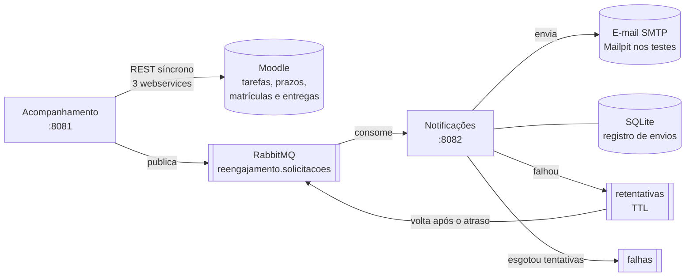

# Serviço de reengajamento de estudantes integrado ao Moodle

Projeto extensionista de Engenharia de Software II (PUCRS, 2026/2).

Dois microsserviços que, a cada hora, consultam o Moodle e enviam um e-mail de
lembrete para cada aluno que ainda não enviou uma tarefa com prazo nas
próximas 24 horas. O e-mail traz o nome da tarefa, o prazo e o link de acesso.



| Serviço | Responsabilidade |
|---|---|
| **Acompanhamento** | Consulta o Moodle periodicamente (`INTERVALO_SEGUNDOS`, padrão 1h), identifica alunos com tarefas pendentes que vencem em `JANELA_HORAS` (24h) e publica uma solicitação de reengajamento por aluno e tarefa na fila. |
| **Notificações** | Consome a fila, envia o lembrete por SMTP e registra o resultado. Usa a chave `curso:tarefa:aluno` para não reenviar o que já foi processado. Falhas são registradas e retentadas automaticamente. |
| moodle-mock | Moodle simulado com as mesmas três funções REST e o mesmo formato de resposta. Só para desenvolvimento e demonstração. |

Webservices do Moodle usados:

| Função | Para quê |
|---|---|
| `mod_assign_get_assignments` | Tarefas e prazos |
| `core_enrol_get_enrolled_users` | Alunos matriculados (e e-mails) |
| `mod_assign_get_submissions` | Quem já entregou |

## Como rodar

Pré-requisito: Docker Desktop (ou Docker Engine + Compose v2.24+). Python 3.10+ só é
necessário para o script de verificação e os testes.

```bash
cp .env.example .env          # Windows: copy .env.example .env
docker compose up -d --build
```

| Endereço | O que é |
|---|---|
| http://localhost:8025 | **Mailpit**: caixa de entrada com os lembretes enviados |
| http://localhost:15672 | Painel do RabbitMQ (usuário `guest`, senha `guest`): filas e mensagens |
| http://localhost:8081/ultimo | Resultado do último ciclo do Acompanhamento |
| http://localhost:8082/envios | Registro de envios (status, tentativas, último erro) |
| http://localhost:8082/eventos | Histórico: enviados, duplicados ignorados, falhas |
| http://localhost:8000/admin/estado | Dados do Moodle simulado |

Com o `.env` de demonstração, o ciclo roda a cada 30 s. Em poucos segundos os 4
lembretes esperados aparecem no Mailpit.

Para executar um ciclo na hora, sem esperar o intervalo:

```bash
curl -X POST http://localhost:8081/executar
```

(No PowerShell do Windows, use `curl.exe` em vez de `curl`.)

Logs: `docker compose logs -f acompanhamento notificacoes`

## Verificar os critérios de aceite

```bash
python scripts/verificar_criterios.py
```

O script recria os dados, roda os ciclos, derruba e religa o Mailpit, e imprime
`PASSOU`/`FALHOU` para cada critério:

1. Um lembrete para tarefa pendente dentro da janela de 24 horas.
2. Nenhum lembrete para tarefa já enviada ou fora da janela.
3. Nenhum novo envio ao reprocessar uma solicitação concluída.
4. Registro de falhas e nova tentativa de processamento.

Salve a saída como registro dos testes:
`python scripts/verificar_criterios.py > docs/registro-verificacao.txt`

## Dados do Moodle simulado

Os prazos são relativos ao momento em que o serviço sobe, então a demo funciona a qualquer hora.

| Tarefa | Prazo | Situação | Lembrete para |
|---|---|---|---|
| 1. Relatório da Sprint 3 | +6h | Bruno entregou; Carla só tem rascunho | Ana, Carla, Diego |
| 2. Checklist de validação | +20h | só Bruno não entregou | Bruno |
| 3. Diagrama de arquitetura | +72h | fora da janela | ninguém |
| 4. Questionário 1 | −24h | vencida | ninguém |
| 5. Trabalho em grupo | +10h | entrega em grupo (fora do escopo) | ninguém |
| 6. Leitura complementar | sem prazo | | ninguém |

A professora (papel `editingteacher`) nunca recebe lembrete.

Rotas de apoio (só no mock): `POST /admin/entregar {"tarefa_id":1,"aluno_id":11}`,
`POST /admin/tarefas {"nome":"...","horas":2}`, `POST /admin/reset`.

## Usar um Moodle real

Nenhum código muda. No `.env`:

```ini
MOODLE_URL=https://moodle.sua-instalacao.br
MOODLE_URL_PUBLICA=https://moodle.sua-instalacao.br
MOODLE_TOKEN=<token do webservice>
MOODLE_CURSO_ID=<id da disciplina>
INTERVALO_SEGUNDOS=3600
PERMITIR_LIMPEZA=false
```

No Moodle (Administração do site → Servidor → Serviços web):

1. Habilitar serviços web e o protocolo REST.
2. Criar um serviço externo com as três funções acima.
3. Criar um usuário de serviço com permissão para ver tarefas, envios e participantes
   da disciplina. Para o e-mail vir em `core_enrol_get_enrolled_users`, ele precisa da
   capacidade `moodle/course:useremail` ou de ver os e-mails dos usuários.
4. Gerar o token para esse usuário e serviço.

Para SMTP real, preencha `SMTP_HOST`, `SMTP_PORTA`, `SMTP_USUARIO`, `SMTP_SENHA` e
`SMTP_STARTTLS=true`.

## Testes automatizados

```bash
pip install -r requirements-dev.txt
cd acompanhamento && python -m pytest -v && cd ..
cd notificacoes   && python -m pytest -v && cd ..
```

- `acompanhamento/tests/test_selecao.py`: regras da janela, entregas, rascunho, grupo, sem prazo, vencida, limites.
- `acompanhamento/tests/test_integracao_moodle.py`: cliente REST contra o Moodle simulado via HTTP.
- `notificacoes/tests/test_processador.py`: idempotência (inclusive após reinício), falha + retentativa, esgotamento, roteamento entre filas e conteúdo do e-mail.

## Decisões de projeto

- **Pendente** = estudante matriculado com e-mail **menos** quem tem envio com status
  `submitted`. Rascunho (`draft`) conta como pendente. `mod_assign_get_submissions` só
  devolve quem tem algum registro, então a lista de matriculados é necessária.
- **Janela**: `agora < prazo ≤ agora + 24h`, tudo em timestamp Unix (UTC). O prazo é
  formatado no fuso `America/Sao_Paulo` só no texto do e-mail.
- **Idempotência fica no Notificações**, que é quem sabe se o e-mail saiu. O
  Acompanhamento pode publicar a mesma solicitação a cada hora; o Notificações ignora
  as que já constam como `enviado` no SQLite (volume Docker, sobrevive a reinícios).
- **Confirmação manual (ack)**: a mensagem só é confirmada depois de decidido seu destino.
  Se o serviço cair no meio, o RabbitMQ reentrega.
- **Retentativa sem bloquear a fila**: a mensagem que falha vai para
  `reengajamento.retentativas` com TTL; ao expirar, volta sozinha para a fila principal
  (dead-letter). Depois de `MAX_TENTATIVAS`, vai para `reengajamento.falhas`.
- **Prazo único**: prorrogações individuais (overrides) estão fora do escopo e não são consultadas.

## Limitações conhecidas

- Se o serviço cair exatamente entre o envio SMTP e a gravação no banco, aquele lembrete
  pode sair duas vezes ao ser reentregue (garantia "pelo menos uma vez").
- Uma disciplina por instância (`MOODLE_CURSO_ID`), conforme o escopo.

## Estrutura

```
acompanhamento/   microsserviço 1 (Python, requests + pika)
notificacoes/     microsserviço 2 (Python, pika + smtplib + SQLite)
moodle-mock/      Moodle simulado (Flask)
scripts/          verificar_criterios.py
docs/             roteiro da demonstração e registro dos testes
```

## Referências

- Mailpit: https://mailpit.axllent.org/
- RabbitMQ: https://www.rabbitmq.com/
- Moodle: https://moodle.org/
- Moodle Web service API functions: https://docs.moodle.org/dev/Web_service_API_functions
- Moodle Using web services: https://docs.moodle.org/en/Using_web_services
